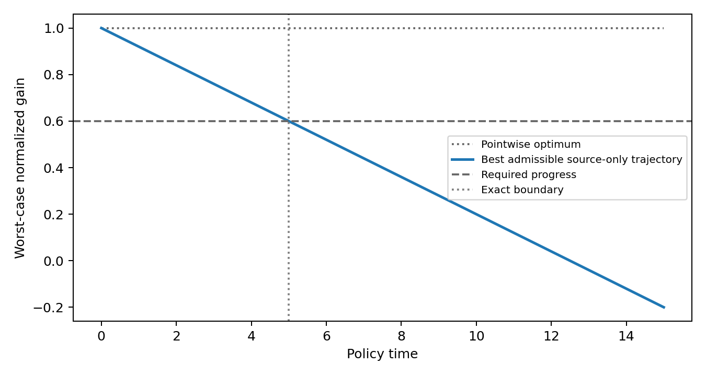
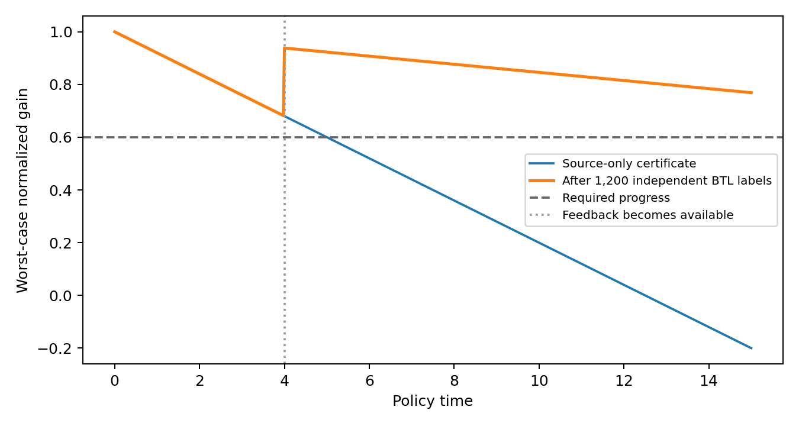
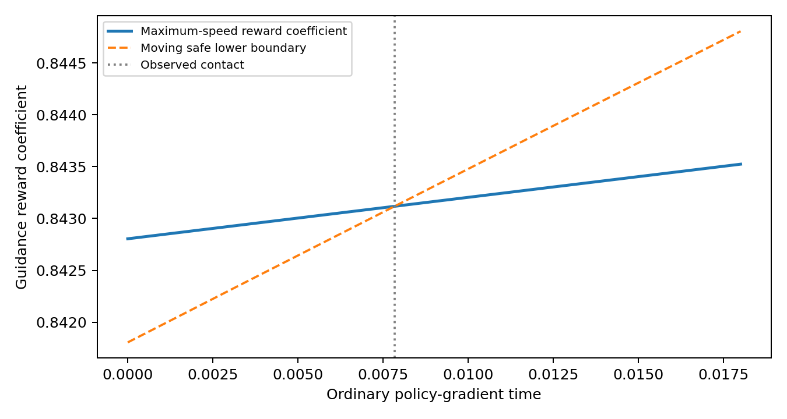

# ⏳ The Horizon of Reward Guidance

🌍 Languages: [English](README.md) | [中文](README_cn.md)

👉 **TL;DR.** Preference feedback can still certify a useful policy update even when it leaves some reward directions unknown. But as the policy changes, the set of rewards that certify progress can move faster than the deployed reward can adapt. **The Horizon of Reward Guidance** characterizes how long existing preference information can certify continued progress, demonstrates failure of trajectory feasibility despite pointwise feasibility, and analyzes the additional binary preference feedback needed to certify a longer horizon.

<p align="center">
  <b>📄 arXiv coming soon</b> &nbsp; | &nbsp;
  <a href="#-quickstart"><b>🚀 Quickstart</b></a> &nbsp; | &nbsp;
  <a href="#-demo"><b>🧪 Demo</b></a>
</p>

## 🎥 Overview

<p align="center">
  
</p>

**Figure 1.** The pointwise reward optimum stays available, but the source-only certificate of the moving reward trajectory reaches the required progress threshold at time **5**. In the paper's five-output finite model, an illustrative batch of 1,200 targeted binary preference labels narrows the ambiguity set so that the **same trajectory** remains certified through time **15**. This is a numerical illustration under the stated assumptions, not an experiment training a neural reward model.

---

## ✨ Highlights

- 🎯 **Exact scalar horizon.** A necessary-and-sufficient bound for continued robust progress when the certified reward target moves faster than the available adaptation speed.
- 🔄 **Pointwise is not trajectory feasibility.** A reward may certify progress at every policy state even when no admissible reward path from the initial parameters can maintain that certificate.
- 📈 **Ordinary policy gradient.** The local separation also occurs with standard Euclidean policy gradient and full-support policies, not only with a constructed preconditioner.
- 🧮 **Preference-feedback complexity.** Under a bounded Bradley–Terry comparison model, instance-level label complexity scales with distance to the dynamic infeasibility boundary, not merely time.
- 🧪 **Reproducible finite-model evidence.** CPU-only code, three demos, all original numerical checks and the data for seven paper figures; no model checkpoints or API access required.

---

## 📐 What the Horizon Measures

In the scalar model, the true normalized progress under a preference parameter $`\delta`$ is

$$j_{\delta}(t)=g+\delta\,[\phi(t)-vt],\qquad
\delta\in[-\eta_0,\eta_0],\qquad \phi(0)=0,\quad |\dot\phi|\le\rho.$$

Here $`g`$ is the source-identified common gain, $`vt`$ is the moving target reward coefficient, $`\phi(t)`$ is the deployed guidance coefficient, $`\eta_0`$ bounds unresolved preference uncertainty, and $`\rho`$ bounds reward adaptation speed. The minimum guaranteed progress is

$$L(t)=g-\eta_0|\phi(t)-vt|.$$

For $`0<\gamma<g`$, $`0\le\rho<v`$, and with nonbinding reward-amplitude constraints, the **exact** source-only support horizon is

$$\boxed{T_0=\frac{g-\gamma}{\eta_0(v-\rho)}}.$$

The admissible path $`\phi(t)=\rho t`$ attains this bound. In contrast, if the instantaneous reward target $`\phi=vt`$ is allowed, pointwise optimization always attains $`g`$. Therefore pointwise feasibility need not imply dynamically maintainable certification.

Three distinct notions matter:

| Question | Object | What it does **not** establish |
|---|---|---|
| **Pointwise feasibility** | Is there a certifying reward at the current policy state? | A continuous, sufficiently fast path to that reward |
| **Trajectory feasibility** | Is there an admissible path from the declared initialization that stays certified? | A concrete reward optimizer necessarily follows that path |
| **Statistical certification** | Do source data and new labels exclude dynamically infeasible preference alternatives? | That the physical adaptation speed or control path improved |

The paper additionally analyzes finite reward-update resources, local ordinary-policy-gradient separation, and the information needed for longer-horizon certification.

---

## 🔎 Main Results

### 1. Source-only horizon versus feedback-extended certification

| Quantity | Paper example |
|---|---:|
| Exact source-only support horizon | **5.0** |
| Targeted preference comparisons | 1,200 |
| Representative positive labels | 600 |
| Horizon checked after feedback | **15.0** |
| Minimum post-query certificate on the illustrated trajectory | **0.682** |
| Required normalized gain | 0.600 |

The post-query certificate includes a fixed feedback-availability time $`t=4`$. The observed binary labels are an **illustrative batch**, not labels gathered from real annotators.

### 2. Discrete reward updates are a resource constraint

| Reward updates per policy step $`m`$ | First uncertified time | Ideal step-budget envelope |
|---:|---:|---:|
| 0 | 3.35 | 3.35 |
| 1 | 4.55 | 5.05 |
| 2 | 7.85 | 10.05 |
| 3 | Not within 15 | Not within 15 |

This experiment uses a **clipped quadratic reward-calibration rule**, not a Bradley–Terry likelihood optimizer. The policy uses fixed Euler steps of $`0.05`$; all rows share the policy step size, clipping and learning-rate settings. These are finite-step gain measurements, not a continuous-time certification of the simulated optimizer.

### 3. Preference certification depends on the boundary gap

For target horizon $`T`$ beyond the source-only horizon, define

$$d_T=\frac{g-\gamma}{(v-\rho)T}-\delta_{\star}>0.$$

With a bounded Bradley–Terry comparison pool containing an informative pure comparison, the paper establishes matching expected-information lower and fixed-batch upper orders

$$\boxed{N=\Theta\!\left(d_T^{-2}\log(1/\alpha)\right)}$$

for fixed comparison bounds and appropriate error probability $`\alpha`$. The result is **instance-level**: proximity to the infeasibility boundary determines the statistical difficulty. When the true preference is dynamically infeasible, new labels cannot fix the adaptation constraint.

---

## ⚙️ Install

Python **3.10+**. The scalar analysis in [`horizon.py`](horizon.py) uses the standard library; the demos and full experiments use NumPy, SciPy and Matplotlib.

```bash
git clone https://github.com/AtheavenMa/The-Horizon-of-Reward-Guidance.git
cd The-Horizon-of-Reward-Guidance
python -m pip install -r requirements.txt
```

---

## 🚀 Quickstart

```python
from horizon import analyze_horizon

result = analyze_horizon(
    gain=1.0,
    required_gain=0.6,
    uncertainty_radius=1.0,
    drift_speed=0.12,
    adaptation_speed=0.04,
    target_horizon=15.0,
)

print(result.support_horizon)      # 5.0
print(round(result.minimum_required_speed, 6))  # 0.093333
print(result.pointwise_feasible)   # True
print(result.trajectory_feasible)  # False
```

For discrete externally specified moving intervals, use [`interval_feasible`](horizon.py) to obtain a feasible path or an infeasible verdict **on the specified time nodes**. For bounded-model Bradley–Terry calculations, use `btl_sample_bounds`, `certify_btl_batch`, or `btl_confidence_interval`. These are mathematical-model utilities, not a general policy/RLHF safety oracle. See the [public API reference](docs/API.md) for precise hypotheses, inputs and return types.

---

## 🧪 Demo

**Exact scalar horizon**

```bash
python demo/demo.py
```

<p align="center"></p>

Computes $`T_0=5`$, checks a target horizon of 15, and saves `outputs/demo_horizon/demo_output.png` and `summary.json`.

**Feedback-extended certification**

```bash
python demo/demo_feedback.py
```

<p align="center"></p>

Reproduces the illustrative 600/1,200 BTL batch, its two-sided confidence interval, the paper's post-query minimum certificate of 0.682, and the separate one-sided fixed-batch feasibility test.

**Local ordinary-policy-gradient separation**

```bash
python demo/demo_ordinary_pg.py
```

<p align="center"></p>

Computes the local analytic all-controls upper bound and numerically locates boundary contact for the reward path moving at maximal speed. The proof of the all-controls claim is in the paper; the plot alone cannot establish it.

---

## 🗺️ Figure Map

All seven manuscript figures, their frozen data sources, and the corresponding plotting functions are indexed in [Figure Map](docs/FIGURE_MAP.md). The published figures are produced from the original numerical scripts and recorded parameters, not invented images.

---

## 🔬 Full Numerical Reproduction

```bash
python experiments/reproduce.py --all
```

This reruns the original inherited verification suite, the discrete-resource experiment and the independently recomputed prediction-versus-guidance example, recreates **all seven** figures, and compares CSV/JSON results against the frozen inputs in [`results/reference/`](results/reference). Generated outputs are written separately to `outputs/paper_reproduction/`.

Run the mathematical unit tests with:

```bash
python -m pip install pytest
python -m pytest -q
```

The original experiments are preserved in [`experiments/`](experiments), and the paper plotting scripts are in [`plotting/`](plotting). See the [reproduction guide](docs/REPRODUCE.md) and [complete paper results](docs/PAPER_RESULTS.md). The original numerical checks are designed to verify finite-model calculations, not to replace the analytic proofs.

---

## ⚠️ Scope and Preprint Status

- This release contains **synthetic finite-output policy and scalar preference models**, not neural reward-model training, PPO, GRPO or LLM benchmarks.
- Some checks use binary Bradley–Terry labels; a separate weak-identification calculation uses Gaussian scores. Do not conflate their data models.
- A reward *speed envelope* bounds what any optimizer might do; finding a feasible path does not prove a particular optimizer will track it.
- The full manuscript is not distributed in this repository. **arXiv coming soon.** All numerical results, figures, demos and verification code remain available.
- Full results use independent simulation or exact computation where stated. The seven paper figures are illustrations and finite-model numerical evidence; no claim of neural-network empirical validation is made.

---

## 🙏 Appreciation

We acknowledge the prior work in preference learning, policy optimization, safe control, and information theory cited in the manuscript. Numerical verification of a theorem does not replace its proof or a literature priority review.

## 📜 Citation and License

**Paper preprint: arXiv coming soon.** The manuscript is not included in this repository. Once the public preprint is available, please use its official record for paper citations. [`CITATION.cff`](CITATION.cff) describes the software artifact, not the manuscript author list. The original code and project documentation are [MIT licensed](LICENSE); the forthcoming manuscript and third-party materials have separate copyright and publication terms as described in [Third-party notices](THIRD_PARTY_NOTICES.md).


For development and first-public-release steps, see [Contributing](CONTRIBUTING.md), [Changelog](CHANGELOG.md), and the [release checklist](RELEASE_CHECKLIST.md).
