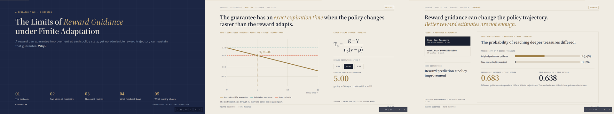

# ⏳ The Limits of Reward Guidance under Finite Adaptation

🌍 Languages: [English](README.md) | [中文](README_cn.md)

👉 **TL;DR.** 即使偏好反馈还无法完全确定真实奖励，它仍然可能足以保证当前策略更新有益。但随着策略持续变化，能够保证进展的奖励参数也可能变化得比实际奖励的适应速度更快。**The Limits of Reward Guidance under Finite Adaptation** 研究已有偏好信息能够在多长时间内持续认证策略改进、新增反馈什么时候有帮助，以及不同奖励如何影响实际策略训练。

  <b>📄 arXiv coming soon</b> &nbsp; | &nbsp;
  <a href="https://atheavenma.github.io/The-Limits-of-Reward-Guidance-under-Finite-Adaptation/"><b>🎞️ 5 分钟讲解</b></a> &nbsp; | &nbsp;
  <a href="#-主要结果"><b>📊 主要结果</b></a> &nbsp; | &nbsp;
  <a href="#-快速上手"><b>🚀 快速上手</b></a>

## 🎥 Overview

  

**Figure 1.** (a) 随着策略变化，能够保证进展的奖励参数区间也在移动。允许最快变化的奖励轨迹在 \(T_0=5\) 时到达区间边界，之后无法继续保持认证。(b) 原有偏好数据提供的保证在 \(T_0\) 时达到最低进展要求，尽管每个时刻仍然存在合适的奖励。新增 1,200 条有针对性的偏好比较后，同一条轨迹上的保证得到延长，策略本身不因这批信息而改变。

核心问题是：随着策略状态变化，实际奖励能否持续保证足够的进展。即使每个时刻都存在合适的奖励，也不意味着从给定初始条件出发，存在一条满足适应限制的奖励轨迹。

---

## 🎞️ 5 分钟讲解

  

💻 在浏览器中打开[五分钟讲解](https://atheavenma.github.io/The-Limits-of-Reward-Guidance-under-Finite-Adaptation/)；也可以下载[独立 HTML 文件](docs/index.html)在本地打开。

---

## ✨ 主要发现

- ⏳ **有限的支持期限。** 在标量模型中，我们精确推导已有偏好信息能够持续认证策略进展的时间。
- ⚖️ **逐点可行不代表轨迹可行。** 在普通 Euclidean Policy Gradient 下也会出现这一差别。即使每个状态都有合适奖励，有限的奖励适应能力仍可能不足以维持认证。
- 📏 **反馈成本取决于具体偏好。** 认证更长时间所需的信息量取决于真实偏好到动态可行性边界的距离。
- 🧭 **奖励指导会改变训练结果。** Deep-Sea-Treasure 实验表明，不同指导奖励可能在有限训练后产生不同的策略行为。
- ⚠️ **更多信息未必带来更好的最终策略。** 更多人类偏好比较可以改善奖励估计，但在 Pythia-1B 的实验中，新增 AI 反馈没有产生可确认的最终质量提升。

---

## 💡 为什么 Reward Guidance 有 Horizon？

现有偏好数据能够排除部分奖励参数，却不一定能区分所有真正不同的奖励函数。在某个策略状态，所有兼容偏好可能都认可某个更新方向，因此当前指导可以被认证。但在后续策略状态，相同的未知方向可能变得重要。

关键是要区分三个问题：

| 层次 | 核心问题 |
|---|---|
| **Pointwise Feasibility** | 当前状态是否存在合格奖励？ |
| **Trajectory Feasibility** | 从初始奖励出发，速度受限的路径能否始终保持认证？ |
| **Statistical Certification** | 偏好信息能否认证给定目标期限？ |

因此，Reward Guidance 的失效可能是 **轨迹无法跟上移动约束**，也可能是 **当前偏好信息不足以证明它能跟上**。额外标签能解决第二个问题，但不能自动解决第一个问题。

---

## 📐 数学定义

标量模型的真实归一化进展写为

$$j_\delta(t)=g+\delta[\phi(t)-vt],\quad
\delta\in[-\eta_0,\eta_0],\quad
\phi(0)=0,\quad |\dot\phi|\le\rho.$$

其中 $g$ 为已有偏好信息能够确定的共同进展，$vt$ 为随策略变化的目标奖励系数，$\phi(t)$ 为实际指导系数，$\eta_0$ 描述偏好未识别方向的范围，$\rho$ 是奖励参数允许的最大适应速度。

对所有兼容偏好取最差情况，得到证书：

$$L(t)=g-\eta_0|\phi(t)-vt|.$$

当 $0<\gamma<g$、$0\le\rho<v$ 且奖励幅度约束不会先成为瓶颈时，精确支持期限为

$$\boxed{T_0=\frac{g-\gamma}{\eta_0(v-\rho)}}.$$

轨迹 $\phi(t)=\rho t$ 能达到这个上界。与此同时，如果允许每个时刻独立选择 $\phi=vt$，逐点最优值始终为 $g$。这就产生了论文的核心分离：**逐点有解，但全程没有可到达的解。**

针对更长的目标期限 $T$，论文还证明在给定条件下，Bradley–Terry 比较的标签复杂度为

$$\boxed{N=\Theta\!\left(d_T^{-2}\log(1/\alpha)\right)},\qquad
d_T=\frac{g-\gamma}{(v-\rho)T}-\delta_\star>0.$$

请参阅 [理论与假设说明](docs/THEORY.md)，了解模型来源、适用条件与定理边界。

---

## 📊 主要结果

📈 Figure 2. 偏好标签需求取决于距离动态不可行边界有多近

两个偏好实例即使需要认证相同的目标期限，所需标签数也可能明显不同。在 \(T=15\) 时，三个实例的二次下界约为 **112 至 1,789 次比较**。决定统计难度的是到动态可行性边界的距离 \(d_T\)，其对应的数量级为 \(d_T^{-2}\)。

这里讨论的是**认证需要多少信息**，不是训练回报增加了多少。

🧭 Figure 3. 普通策略梯度下也可能无法持续维持认证

在允许的最大适应速度下，奖励参数约在 **0.007836** 时到达认证区间的边界，尽管当时的逐点最优进展仍然高于所要求的水平。局部分析还表明，在所讨论系统内，所有允许的奖励轨迹都会在时间 **0.010006** 之前失去认证。

这里的数值接触时间和解析上界对应不同结论，不能混为一谈。

🧩 Figure 4. 奖励指导会影响策略最终学到的行为

在 Deep-Sea-Treasure 经过 **160 次更新**后，基于原有偏好信息的指导策略到达较深宝藏的概率为 **45.6%**，而该实验中使用真实奖励的普通策略梯度为 **0.8%**。两者最终平均真实回报分别为 **0.683** 和 **0.638**。

这些方法的奖励指导规则并不完全相同。结果说明有限训练过程依赖所经历的策略轨迹，并不是说未知奖励普遍优于真实奖励。

🔬 Figure 5. 更多人类偏好比较改善了奖励估计

随着人类偏好训练比较数从 **257** 增加到 **4,098**，Qwen2.5-0.5B 奖励模型的平均偏好预测准确率从 **50.5%** 提高到 **56.3%**，负对数似然也有所下降。然而，在独立最终测试集上，基于文本长度和重合度的简单 Logistic Regression 达到了 **58.3%**。

奖励预测得到改善，不等于持续的策略指导已经得到保证。

🎯 Figure 6. 新增反馈与有限奖励适应能力

在 Pythia-1B 的 **64 次策略更新**中，奖励模型获得 **96 条新增 AI 偏好比较**。六次奖励更新均满足在固定比较集合上定义的 **0.05** 幅度限制，但相较于固定奖励，最终独立 ROUGE-L 的平均差值为 **−0.0017**（两个独立训练种子的 95% 配对区间为 **[−0.0159, 0.0124]**）。

实验说明奖励更新可以遵守有限预算，但新增信息没有带来可确认的最终性能改善。这并不是对任意神经网络的支持期限证明。

完整的实验设置、统计限定和结果来源见 [Main Results](docs/RESULTS.md) 与 [论文实验说明](docs/PAPER_EXPERIMENTS_08.md)。

---

## 🔢 有限奖励更新的数值实验

原有实验还研究了每次策略更新前允许执行多少次奖励参数优化。这里使用的是经过截断的二次奖励校准，并非收集新的偏好标签。策略步长固定为 0.05，其他优化设置保持不变。

<table align="center">
  <thead>
    <tr>
      <th align="center">每次策略更新前的奖励更新次数</th>
      <th align="center">首次无法认证进展的时间</th>
      <th align="center">理想更新预算对应时间</th>
    </tr>
  </thead>
  <tbody>
    <tr><td align="center">0</td><td align="center">3.35</td><td align="center">3.35</td></tr>
    <tr><td align="center">1</td><td align="center">4.55</td><td align="center">5.05</td></tr>
    <tr><td align="center">2</td><td align="center">7.85</td><td align="center">10.05</td></tr>
    <tr><td align="center">3</td><td align="center">15 内未失去认证</td><td align="center">15 内未失去认证</td></tr>
  </tbody>
</table>

实际更新规则不能立即达到允许的最大速度，因此可能比理想预算更早失去认证。这与新增偏好比较能减少多少不确定性是两个不同问题。[完整数值结果](docs/PAPER_RESULTS.md)。

---

## ⚙️ 安装

支持 Python 3.10+。

~~~bash
git clone https://github.com/AtheavenMa/The-Limits-of-Reward-Guidance-under-Finite-Adaptation.git
cd The-Limits-of-Reward-Guidance-under-Finite-Adaptation
python -m pip install -e ".[demo]"
~~~

## 🚀 快速上手

运行精确标量例子：

~~~python
from horizon import analyze_horizon

result = analyze_horizon(
    gain=1.0,
    required_gain=0.6,
    uncertainty_radius=1.0,
    drift_speed=0.12,
    adaptation_speed=0.04,
    target_horizon=15.0,
)
print(result.support_horizon)      # 5.0
print(result.pointwise_feasible)   # True
print(result.trajectory_feasible)  # False
~~~

生成示例图：

~~~bash
python demo/demo_feedback.py
~~~

还可以通过 [Reward Guidance Audit](docs/AUDIT.md) 使用自己的概率与奖励数据计算有限模型中的可认证进展：

~~~bash
horizon-audit audit --manifest examples/08_guidance_audit/finite_computed.json --out outputs/audit_demo
~~~

Audit 工具会将严格的有限模型计算与神经网络上的经验结果区分开。

---

## 🗺️ 图表索引

| 图片 | 主要问题 | 格式 |
|---|---|---|
| Figure 1 | 已有偏好信息能够持续认证多久？ | [PNG](assets/figures/fig1.png) · [SVG](assets/figures/fig1.svg) · [PDF](assets/figures/fig1.pdf) |
| Figure 2 | 超过支持期限后，需要多少新增反馈？ | [PNG](assets/figures/fig2.png) · [SVG](assets/figures/fig2.svg) · [PDF](assets/figures/fig2.pdf) |
| Figure 3 | 有限奖励适应能力能否跟上策略梯度？ | [PNG](assets/figures/fig3.png) · [SVG](assets/figures/fig3.svg) · [PDF](assets/figures/fig3.pdf) |
| Figure 4 | 奖励指导如何影响策略行为？ | [PNG](assets/figures/fig4.png) · [SVG](assets/figures/fig4.svg) · [PDF](assets/figures/fig4.pdf) |
| Figure 5 | 更多人类反馈如何改变奖励估计？ | [PNG](assets/figures/fig5.png) · [SVG](assets/figures/fig5.svg) · [PDF](assets/figures/fig5.pdf) |
| Figure 6 | 有限预算下更新奖励能否改善最终策略？ | [PNG](assets/figures/fig6.png) · [SVG](assets/figures/fig6.svg) · [PDF](assets/figures/fig6.pdf) |

原有数值实验和历史图表索引仍保留在 [Figure Provenance](docs/FIGURE_MAP.md) 中，公开绘图源码见 [plotting](plotting/render_main_figures.py)。

---

## 🔬 实验复现

~~~bash
python -m pytest -q
python experiments/reproduce.py --all
~~~

完整的数值验证和原有图表可独立复现。原有流程还会检查四份 JSON、五份 CSV 和七张历史数值图，与冻结的参考结果逐项比较，输出到 `outputs/paper_reproduction/`，不会覆盖参考数据。真实人类偏好、强化学习和语言模型实验见 [详细结果](docs/RESULTS.md) 和 [复现说明](docs/FINAL_REPRODUCE_08.md)。

## 🙏 致谢

感谢偏好学习、强化学习、安全控制和信息理论领域的研究工作。

## 📚 引用

📄 arXiv coming soon。论文正式公开前，可以通过 [CITATION.cff](CITATION.cff) 引用研究软件。

MIT 许可证 · [贡献说明](CONTRIBUTING.md) · [更新记录](CHANGELOG.md)
