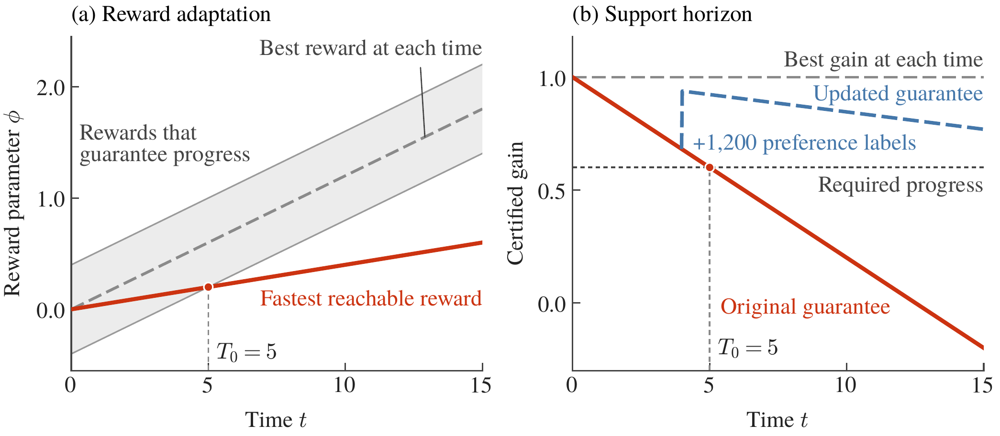
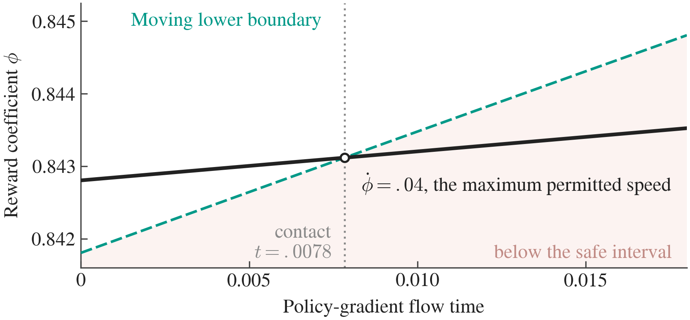
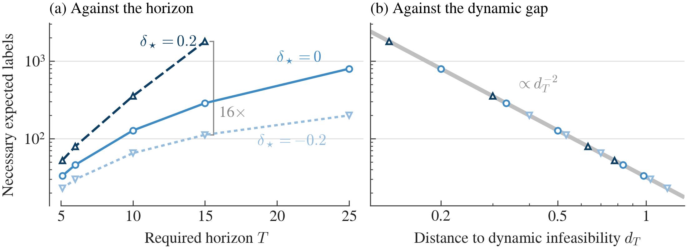
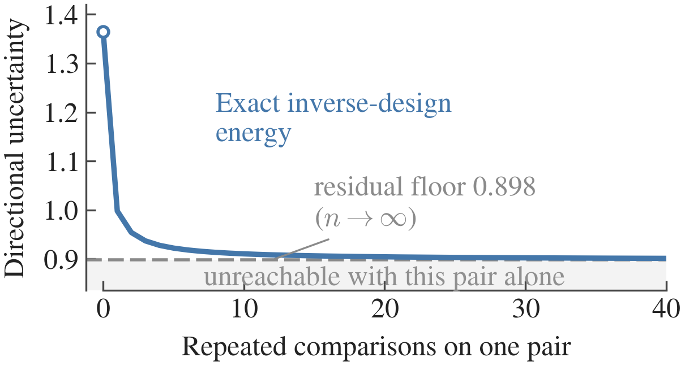
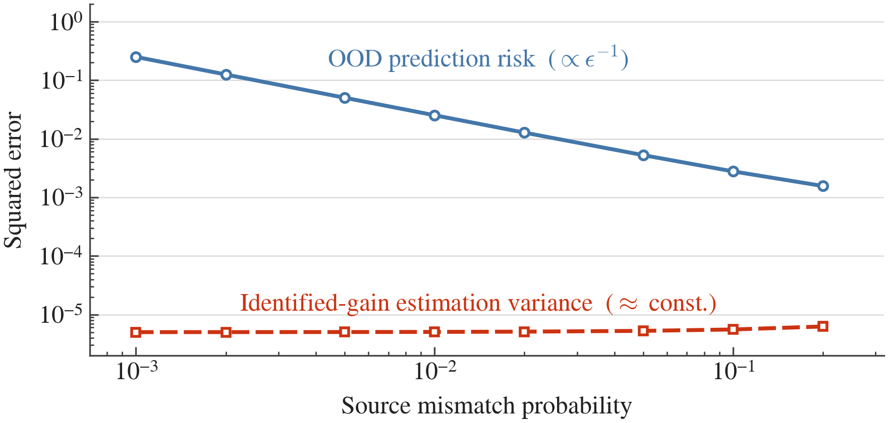
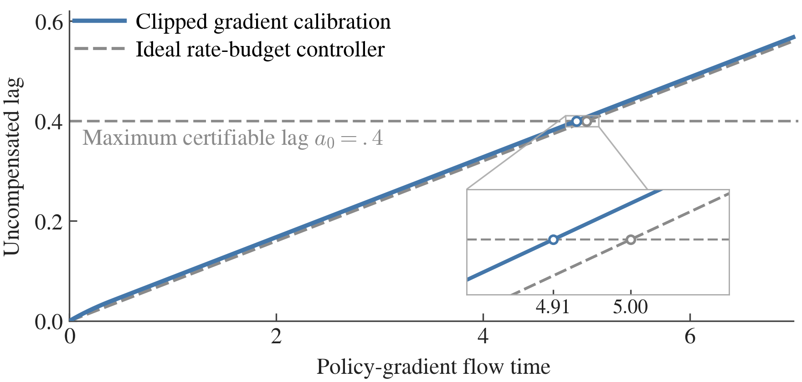
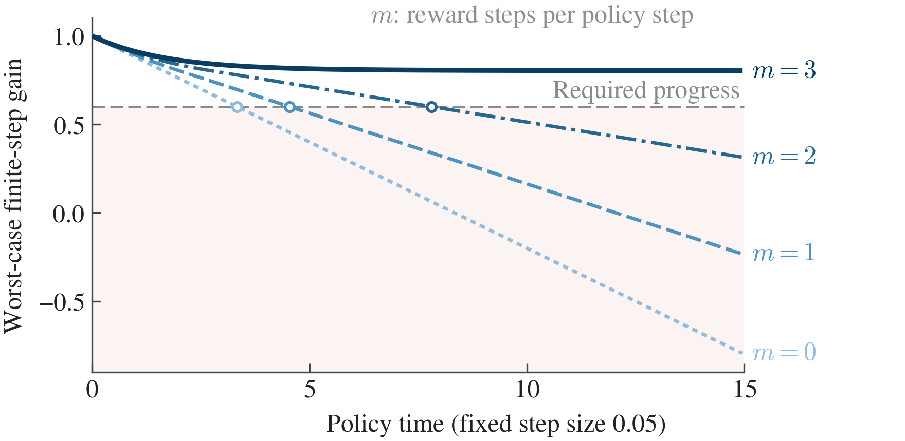

# Figures and Reproduction

## Main Research Figures

The current research overview uses Figure 1 and the five newer figures listed below. Figure 1 has been replaced by the two-panel figure in the current manuscript ZIP. Figures 2–6 remain unchanged. All six main figures are available as PNG, SVG, and PDF.

| Figure | Finding | PNG | SVG | PDF |
|---|---|---|---|---|
| **1** | Existing preference information and additional feedback can certify different durations of progress | [PNG](../assets/figures/fig1.png) | [SVG](../assets/figures/fig1.svg) | [PDF](../assets/figures/fig1.pdf) |
| **2** | Feedback complexity depends on distance to the dynamic feasibility boundary | [PNG](../assets/figures/fig2.png) | [SVG](../assets/figures/fig2.svg) | [PDF](../assets/figures/fig2.pdf) |
| **3** | Certified guidance can fail under ordinary policy gradient | [PNG](../assets/figures/fig3.png) | [SVG](../assets/figures/fig3.svg) | [PDF](../assets/figures/fig3.pdf) |
| **4** | Different guidance rewards lead to different learned policy behavior | [PNG](../assets/figures/fig4.png) | [SVG](../assets/figures/fig4.svg) | [PDF](../assets/figures/fig4.pdf) |
| **5** | More human preference data improve reward estimation | [PNG](../assets/figures/fig5.png) | [SVG](../assets/figures/fig5.svg) | [PDF](../assets/figures/fig5.pdf) |
| **6** | Bounded reward adaptation does not necessarily improve the final policy | [PNG](../assets/figures/fig6.png) | [SVG](../assets/figures/fig6.svg) | [PDF](../assets/figures/fig6.pdf) |

The figures were rendered using [the reproducible plotting script](../plotting/render_main_figures.py). The underlying frozen experimental measurements are explained in [Main Results](RESULTS.md). No additional benchmark measurements were generated for this documentation update.

## Original Numerical Figure Index

The sections below preserve the seven-figure numerical reproduction from the earlier manuscript version. Their original names, datasets and generation commands are retained for reproducibility. This is a **historical figure index**, not the numbering used in the new Main Results section.

Seven figures generated from the numerical results in [`results/reference/`](../results/reference), with high-resolution PNGs in [`assets/figures/`](../assets/figures).

| Manuscript figure | Source data / calculation | Generator | Display |
|---|---|---|---|
| **1**. [Certificate expiration and feedback](#figure-1--closed_loop) | `closed_loop.csv`, `verification_results.json` | `fig_closed_loop` | [`closed_loop.png`](../assets/figures/closed_loop.png) |
| **2**. [Ordinary PG safe boundary contact](#figure-2--ordinary_pg) | `ordinary_pg.csv` | `fig_ordinary_pg` | [`ordinary_pg.png`](../assets/figures/ordinary_pg.png) |
| **3**. [Preference-label complexity](#figure-3--instance_complexity) | `binary_gap_bounds.csv` | `fig_instance_complexity` | [`instance_complexity.png`](../assets/figures/instance_complexity.png) |
| **4**. [Query information energy](#figure-4--query_energy) | Rank-one-design JSON and recorded parameters; plotted curve reconstructed analytically | `fig_query_energy` | [`query_energy.png`](../assets/figures/query_energy.png) |
| **5**. [Weak Gaussian identification](#figure-5--full_support_separation) | `weak_identification.csv` | `fig_full_support` | [`full_support_separation.png`](../assets/figures/full_support_separation.png) |
| **6**. [Clipped calibration versus ideal speed budget](#figure-6--actual_adaptation) | Analytic curve reconstructed from recorded clipped-calibration parameters | `fig_actual_adaptation` | [`actual_adaptation.png`](../assets/figures/actual_adaptation.png) |
| **7**. [Discrete reward update resources](#figure-7--discrete_resources) | `discrete_resources.csv`, `discrete_resources.json` | `fig_discrete_resources` | [`discrete_resources.png`](../assets/figures/discrete_resources.png) |

All generators are in [`plotting/figures.py`](../plotting/figures.py), with shared style in `plotting/paperfig.py`. Relative data paths are resolved by `--res` and output paths by `--out`.

## Figure 1 — closed_loop

The manuscript figure shows the moving reward interval and fastest reachable reward in panel (a), and the original and updated guarantees in panel (b). The reward path reaches the certifying boundary at $t=5$. A representative batch of 1,200 targeted preference labels, available at $t=4$, extends certification along the same trajectory through $t=15$. The historical numerical reproduction still generates its original closed-loop visualization separately.

## Figure 2 — ordinary_pg

The moving lower safe boundary catches the maximal-speed reward coefficient under ordinary Euclidean policy gradient. The numerical contact time is approximately 0.0078. The local analytic bound applies to **all** bounded-speed reward controls in the specified neighborhood.

## Figure 3 — instance_complexity

Instance-dependent necessary expected label lower bounds for requested horizons and different feasible true preferences, under the specified Bradley–Terry query class. Increasing horizon need not have one universal quadratic cost: the primitive difficulty parameter is distance to the dynamic infeasibility boundary.

## Figure 4 — query_energy

A repeated comparison can reduce directional uncertainty but leave a nonzero asymptotic residual if its feature difference does not span all task-relevant unknown directions. This curve is reconstructed from the recorded rank-one model parameters rather than a separate CSV series.

## Figure 5 — full_support_separation

With fixed-design Gaussian ratings and nonzero source support, OOD prediction risk becomes sensitive to a weak direction while estimation variance of an identified common gain stays controlled. The figure plots the two corresponding squared-error measures.

## Figure 6 — actual_adaptation

An explicit clipped quadratic-calibration rule does not immediately use its maximum speed budget. The lag reaches the certification boundary at approximately 4.9055 rather than the ideal-envelope time 5. This curve is analytically reconstructed from recorded parameters.

## Figure 7 — discrete_resources

Actual clipped calibration steps change the first uncertified policy-step time under fixed Euler policy updates. Increasing $m$ changes the number of reward optimization steps, not the underlying policy step size or the clipping threshold.

For numerical results, see [Paper Results](PAPER_RESULTS.md).
