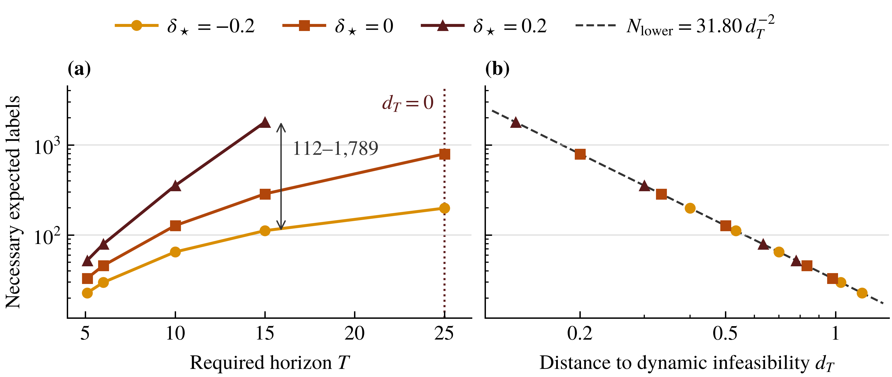
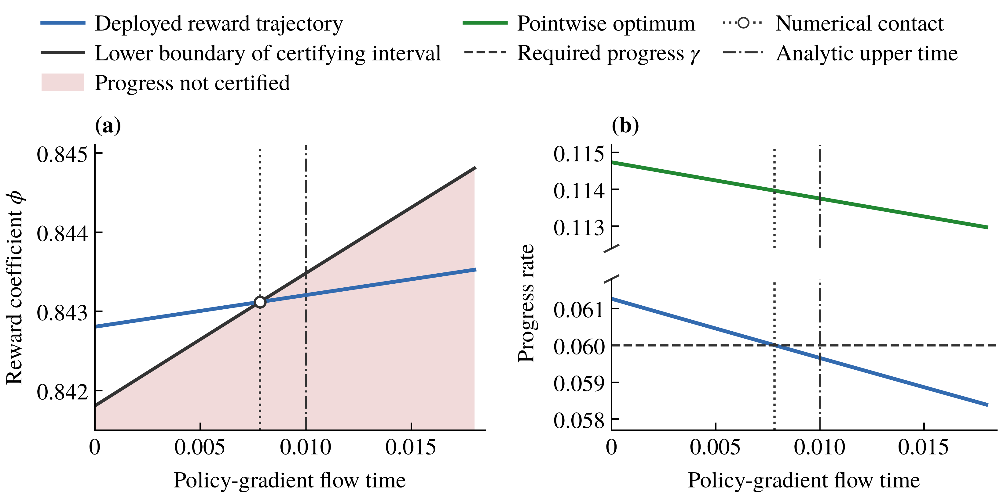
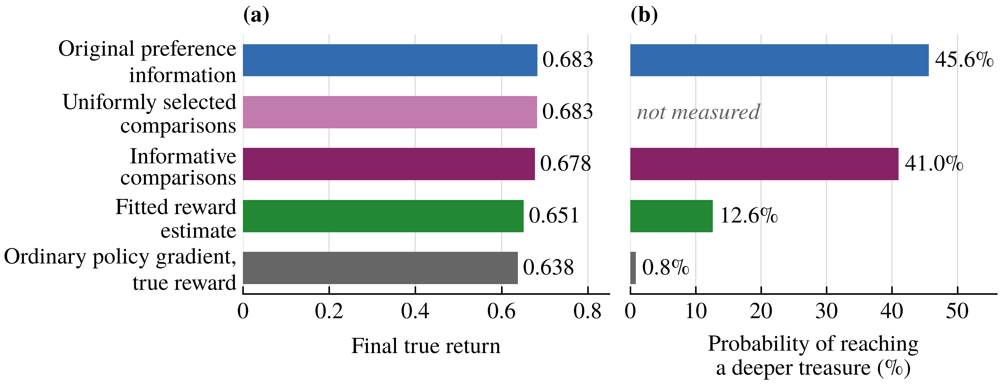
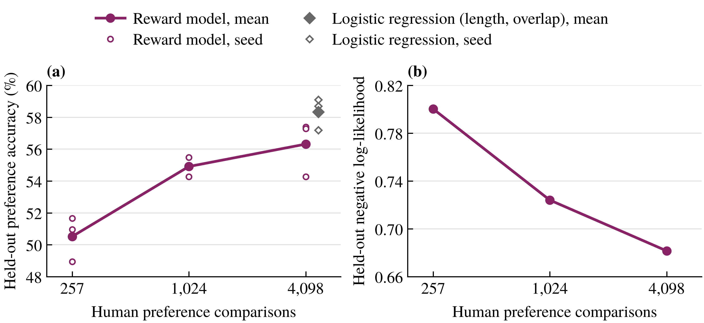
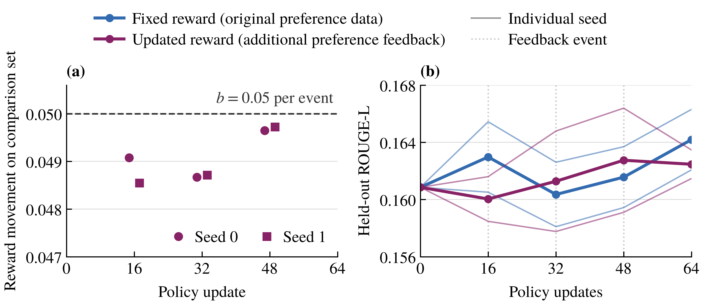

# Main Results

How long can existing preference information certify continued policy improvement as the policy changes? The results below distinguish the existence of a suitable reward at a particular state, the ability to follow a feasible reward trajectory, and what additional preference feedback can establish.

Theoretical and empirical findings have different scopes. Figures 2 and 3 concern the stated mathematical models. Figures 4–6 examine finite learning in reinforcement learning and pretrained language models.

## Figure 1. The Support Horizon of Reward Guidance

The shaded interval in panel (a) shows reward settings that guarantee progress, while the red curve is the fastest reward trajectory reachable from its initialization. Panel (b) compares the guarantee from the original preference data with the guarantee after adding 1,200 targeted comparisons. At time 5 the original guarantee reaches the required progress, although suitable reward settings remain available at each state. Additional preference information extends the guarantee along the same trajectory without changing the policy.

[Editable SVG](../assets/figures/fig1.svg) · [Original manuscript PDF](../assets/figures/fig1.pdf)

## Figure 2. Preference Information Needed Beyond the Horizon

A target horizon beyond the existing support horizon may require additional preference comparisons. The required number depends on the position of the true preference relative to the dynamic feasibility boundary.

For the scalar example, let

\[
d_T=\frac{g-\gamma}{(v-\rho)T}-\delta_\star.
\]

Under the specified informative Bradley–Terry comparison assumptions, the necessary label count has inverse-quadratic dependence on \(d_T\), with the usual logarithmic dependence on the requested error probability.

At target horizon \(T=15\), the quadratic lower bounds for three true preferences are:

| True preference \(\delta_\star\) | Necessary expected labels, lower bound |
|---|---:|
| −0.2 | 111.797 |
| 0 | 286.199 |
| 0.2 | 1788.747 |

The difference matters because **the desired horizon alone does not determine how informative the existing preference data are**. At the feasibility boundary, the relevant gap is zero and no finite value is plotted for that condition.

[Editable SVG](../assets/figures/fig2.svg) · [PDF](../assets/figures/fig2.pdf) · [Mathematical assumptions](THEORY.md)

## Figure 3. Loss of Certified Guidance under Ordinary Policy Gradient

A suitable reward can remain available at every policy state even though a reward constrained to move at a finite rate cannot continue to certify sufficient progress.

In the two-coordinate ordinary Euclidean policy-gradient example, the reward coefficient moving at its maximum permitted speed reaches the lower boundary of the certifying interval at

\[
t_{\mathrm{contact}}\approx 0.00783587.
\]

The required progress is \(0.06\). The pointwise optimum remains above it, while the deployed trajectory's worst-compatible progress falls below it.

The separate local analysis gives an upper time of approximately \(0.01000602\) for the loss of certification under every admissible reward trajectory within the stated system. **The numerical contact of one trajectory and the local analytic all-controls bound are not interchangeable.**

[Editable SVG](../assets/figures/fig3.svg) · [PDF](../assets/figures/fig3.pdf) · [Original numerical analysis](PAPER_RESULTS.md)

## Figure 4. Reward Guidance and the Policy Trajectory

We examine whether the reward used to guide updates can affect the policy states reached later in learning. In Deep-Sea-Treasure, policies can collect a nearby small treasure or continue toward deeper treasures. The recorded outcomes after **160 updates**, averaged over **eight training runs**, are:

| Guidance method | Final true return | Probability of a deeper treasure |
|---|---:|---:|
| Original preference information | 0.683 | 45.6% |
| Uniformly selected comparisons | 0.683 | Not measured |
| Informative comparisons | 0.678 | 41.0% |
| Fitted reward estimate | 0.651 | 12.6% |
| Ordinary policy gradient using the true reward | 0.638 | 0.8% |

The policy behaviors differ substantially. They support the observation that **reward guidance can affect the trajectory of finite policy optimization**.

The compared methods also differ in how their guidance is deployed. These results do not establish that incomplete reward information is generally preferable to the true reward. Controlled comparisons from the same policy state help distinguish changes in information from changes in the guidance rule.

[Editable SVG](../assets/figures/fig4.svg) · [PDF](../assets/figures/fig4.pdf) · [Eight-run results](../outputs/horizon_bridge/r2_dst_paths/summary.json)

## Figure 5. Preference Information and Reward Estimation

We trained a Qwen2.5-0.5B reward model from historically collected **human TL;DR comparisons**. The independent final evaluation contains **995 comparisons**, with **three fitting seeds** per main data size.

| Human comparisons for training | Mean final accuracy | Mean final NLL |
|---|---:|---:|
| 257 | 50.5% | 0.800 |
| 1,024 | 54.9% | 0.724 |
| 4,098 | 56.3% | 0.682 |
| Logistic regression using length and text overlap, 4,098 pairs | 58.3% | Not shown in figure |

More comparisons improved the neural reward model's prediction metrics, but it did not outperform the simpler baseline on final accuracy.

This result concerns **reward estimation**. It does not imply that a policy updated with the learned reward will achieve higher true return or a longer certified support horizon.

[Editable SVG](../assets/figures/fig5.svg) · [PDF](../assets/figures/fig5.pdf) · [Full corrected evaluation](../experiments/horizon_final_08/human_final_holdout/final_metrics_corrected.json)

## Figure 6. Preference Feedback under Finite Reward Adaptation

We update a pretrained **Pythia-1B** summarization policy for **64 steps**. A fixed-reward condition is compared with a reward model that receives **96 additional AI-labeled preference comparisons** in three batches, before policy updates 16, 32 and 48.

The reward model is constrained to change by at most **0.05 at each event**, measured using its scores on a fixed set of comparison pairs. All six recorded reward-update events, across two independent training seeds, satisfy this constraint.

| Quantity | Recorded result |
|---|---:|
| Additional comparisons | 96, labeled by a frozen AI model |
| Largest realized movement at one reward update | 0.0497 |
| Final held-out ROUGE-L difference, updated minus fixed reward | −0.001722 |
| 95% paired interval over two training seeds | [−0.015887, +0.012443] |

The interval includes zero. Additional preference information and a valid bounded reward update therefore **did not produce a confirmed gain in held-out summarization quality** in this experiment.

The movement limit applies to each reward-update event, not cumulative change since initialization. It is measured on a fixed comparison set and does not constitute a formal support-horizon guarantee for neural networks.

[Editable SVG](../assets/figures/fig6.svg) · [PDF](../assets/figures/fig6.pdf) · [Policy and reward-update records](../experiments/horizon_final_08/pythia_bounded/confirm.json)

## Scope and Reproduction

The scalar support-horizon theorem and the local ordinary-policy-gradient result apply to their specified models. The multi-outcome reachable-control calculation remains computational evidence rather than a separately checked outward-rounded proof. The language-model experiments use empirical metrics, and two independent policy seeds limit their statistical precision.

The separate 502-row RewardBench 2 analysis is not an official full-set leaderboard result. A corrected frozen 4B judge comparison was not completed.

For additional detail, see [Theory](THEORY.md), [Experiments for the manuscript](PAPER_EXPERIMENTS_08.md), [Reproduction](FINAL_REPRODUCE_08.md), and the [public audit tool](AUDIT.md).
